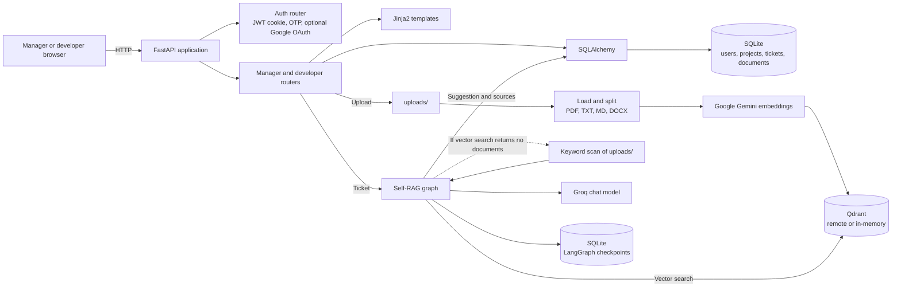
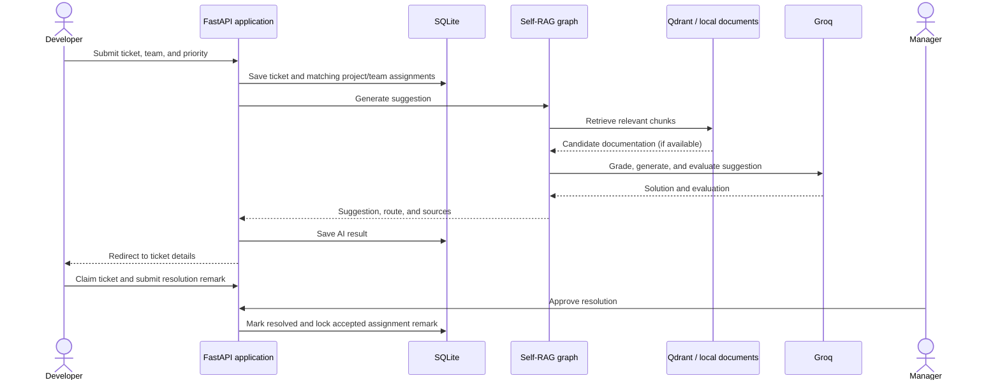
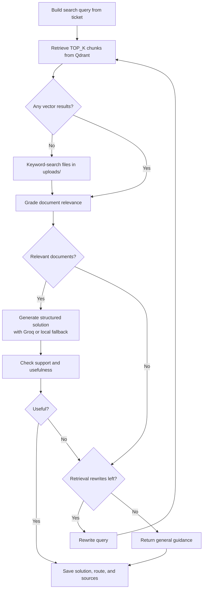
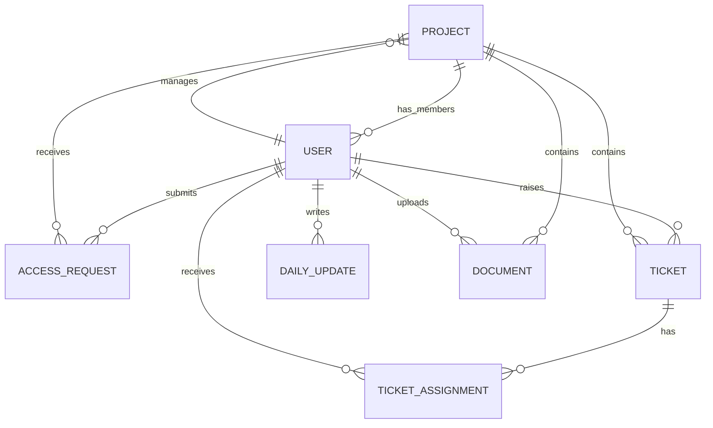

# DevResolve AI

**Turn engineering issues and team knowledge into actionable resolutions.**

DevResolve AI is a FastAPI web application for managing project access, engineering tickets, team assignments, and internal troubleshooting documents. When a developer submits a ticket, a retrieval-augmented generation (RAG) workflow can search uploaded documentation and generate a suggested solution for the team to review.

> **Project status:** This repository contains an application under active development. AI suggestions are advisory; validate them before applying changes to production systems.

## What it does

- **Role-based workspaces** for project managers and developers.
- **Account registration and access approvals** tied to a project.
- **Email/password sign-in with one-time passcode verification**, with optional Google OAuth.
- **Issue tracking** with team, priority, assignment, acceptance, developer remarks, and manager resolution approval.
- **AI-assisted troubleshooting** that searches uploaded runbooks and produces a structured suggestion with source references when available.
- **Knowledge-base uploads** for PDF, TXT, Markdown, and DOCX documents.
- **Developer activity updates** and dashboard summaries.

## How it fits together



The vector collection is shared, and current retrieval does not apply a project filter. Although uploaded files and chunks are associated with a project in application metadata, that metadata is not an access-control boundary for AI retrieval.

### Ticket-to-suggestion flow



Ticket creation is committed before AI generation starts. If generation fails, the ticket remains saved and the detail page can retry generation. AI output is advisory and must be reviewed before use.

### Self-RAG decision flow



Retrieved context is not guaranteed to be project-specific. If Qdrant is unavailable or returns no results, the graph can scan supported files in `uploads/`; the graph also has a structured local solution fallback when model calls fail.

### Core data relationships



`TicketAssignment` records the team-member queue, the developer who accepts a ticket, and that developer's resolution remark. The manager's approval changes the ticket status to `resolved` and locks the accepted assignment's remark.

## Roles and workflows

| Role          | Main capabilities                                                                                                                                                                                 |
| ------------- | ------------------------------------------------------------------------------------------------------------------------------------------------------------------------------------------------- |
| **Manager**   | View dashboards and tickets, approve or reject developer access requests, manage projects and developer roles, upload and review documents, edit profile details, and approve ticket resolutions. |
| **Developer** | Request project access, raise and track issues, accept an assignment, submit a resolution remark, add daily updates, upload troubleshooting documents, and edit profile details.                  |

New developer accounts require manager approval before using the developer workspace. Tickets create assignments for approved developers in the same project whose role matches the selected team. A manager's resolution approval marks the ticket resolved and locks the accepted developer's remark.

## Technology

- **Backend:** Python, FastAPI, SQLAlchemy
- **UI:** Jinja2 server-rendered templates, static CSS and JavaScript
- **Application database:** SQLite
- **AI orchestration:** LangChain and LangGraph
- **LLM:** Groq chat API
- **Embeddings:** Google Generative AI embeddings
- **Vector search:** Qdrant
- **Authentication:** JWT in an HTTP-only cookie, signed session middleware for OAuth, email OTP, optional Google OAuth

## Get started

### Requirements

- Python 3.10 or newer
- `pip`
- API credentials for the AI features you want to enable; see [Configuration](#configuration)

### 1. Create an environment and install dependencies

**Windows PowerShell**

```powershell
py -3 -m venv .venv
.\.venv\Scripts\Activate.ps1
python -m pip install --upgrade pip
pip install -r requirements.txt
```

**macOS / Linux**

```bash
python3 -m venv .venv
source .venv/bin/activate
python -m pip install --upgrade pip
pip install -r requirements.txt
```

### 2. Configure environment variables

Copy `.env.example` to `.env`, then replace placeholders with valid credentials for services you use. For an optional integration you are not configuring, clear both of its credential values; leaving sample placeholders in place may still cause the application to attempt a connection.

**Windows PowerShell**

```powershell
Copy-Item .env.example .env
```

**macOS / Linux**

```bash
cp .env.example .env
```

At minimum, set a private `SECRET_KEY`. To retain model-generated, document-grounded answers across restarts, configure Groq and Google API keys and a persistent Qdrant URL and API key. Without these services, local document search and fallback guidance may still be available. See the [configuration reference](#configuration) for details.

### 3. Start the application

```bash
uvicorn app:app --reload
```

Open [http://localhost:8000](http://localhost:8000). FastAPI's interactive API documentation is available at [http://localhost:8000/docs](http://localhost:8000/docs), and the health endpoint is [http://localhost:8000/health](http://localhost:8000/health).

On startup, the application creates the SQLite tables and seeds example projects and a demo manager account. See [Local demo account](#local-demo-account).

## Configuration

The application reads configuration from environment variables and `.env`. The complete set of example values is in [.env.example](./.env.example).

| Variable                                               | Purpose                                                                                               | Default / notes                                                                                                                                             |
| ------------------------------------------------------ | ----------------------------------------------------------------------------------------------------- | ----------------------------------------------------------------------------------------------------------------------------------------------------------- |
| `APP_URL`                                              | Public base URL used in application links and emails.                                                 | `http://localhost:8000` locally; set to your deployed HTTPS origin in production (for example, `https://devresolve.example.com`, without a trailing slash). |
| `SECRET_KEY`                                           | Signs session data and application JWTs. Use a unique, high-entropy secret outside local development. | Development placeholder; **replace it**.                                                                                                                    |
| `DATABASE_URL`                                         | SQLAlchemy database connection URL.                                                                   | `sqlite:///./data/devresolve.db`                                                                                                                            |
| `DATABASE_PATH`                                        | SQLite file path used to ensure the database directory exists.                                        | `data/devresolve.db`                                                                                                                                        |
| `GOOGLE_CLIENT_ID`, `GOOGLE_CLIENT_SECRET`             | Enable Google OAuth sign-in.                                                                          | Set both to valid credentials or clear both; sample placeholders are not usable.                                                                            |
| `GOOGLE_REDIRECT_URI`                                  | OAuth callback registered with Google.                                                                | `GOOGLE_REDIRECT_URI=https://your-domain.com/auth/google/callbackcallback`                                                                                  |
| `SMTP_HOST`, `SMTP_PORT`, `SMTP_USER`, `SMTP_PASSWORD` | Configure email delivery for OTP and notifications.                                                   | Use valid credentials to send email; clear both user/password values to disable SMTP.                                                                       |
| `FROM_EMAIL`                                           | Sender address for application email.                                                                 | `noreply@devresolve.ai`                                                                                                                                     |
| `GROQ_API_KEY`                                         | Enables the chat model used to generate and evaluate ticket suggestions.                              | Used for model-generated suggestions; local fallback guidance may be available without it.                                                                  |
| `GROQ_MODEL`                                           | Groq model name.                                                                                      | `llama-3.3-70b-versatile`                                                                                                                                   |
| `GOOGLE_API_KEY`                                       | Enables Google embedding requests for document indexing and vector retrieval.                         | Required for vector search; retrieval can fall back to keyword search of local uploads.                                                                     |
| `GEMINI_EMBEDDING_MODEL`                               | Google embedding model name.                                                                          | `gemini-embedding-001`                                                                                                                                      |
| `EMBEDDING_PROVIDER`, `EMBEDDING_DIMENSION`            | Embedding provider setting and Qdrant vector size.                                                    | `google`, `768`; the current vector-store implementation uses Google embeddings.                                                                            |
| `QDRANT_URL`, `QDRANT_API_KEY`                         | Connect to a Qdrant service. Both must be set to use the configured remote service.                   | If either is empty, the app uses an in-memory Qdrant client; its vectors do not persist across restarts.                                                    |
| `QDRANT_COLLECTION_NAME`                               | Collection used for document vectors.                                                                 | `devresolve_docs`                                                                                                                                           |
| `TOP_K`                                                | Number of nearest document chunks requested during retrieval.                                         | `5`                                                                                                                                                         |
| `MAX_SUPPORT_RETRIES`, `MAX_RETRIEVAL_REWRITES`        | Bound support-check and retrieval-rewrite attempts.                                                   | `2` each                                                                                                                                                    |
| `MAX_WEB_REWRITES`                                     | Present in the settings template.                                                                     | No web-search workflow is currently wired into the ticket RAG graph.                                                                                        |
| `OTP_EXPIRE_MINUTES`                                   | OTP expiry setting.                                                                                   | `10`                                                                                                                                                        |

### Local demo account

The startup seed creates this manager account for local evaluation:

```text
Email:    admin@devresolve.ai
Password: Admin@123
```

The current OTP page displays the generated code and the fixed code `123456`; the verifier accepts `123456` as an OTP for any account, subject to the normal expiry check. This behavior is not gated by development mode. It is demo-only and must be removed before deployment. The seed code also resets the demo manager password on every startup; change or remove that behavior before deploying the application. Do not expose the demo account or OTP page to untrusted users.

## AI knowledge-base workflow

1. A manager or developer uploads a `.pdf`, `.txt`, `.md`, or `.docx` document.
2. The application stores the uploaded file in `uploads/`, extracts its text, and splits it into overlapping chunks.
3. Chunks are embedded with the configured Google embedding model and written to the configured Qdrant collection. Project ID is recorded as metadata, but retrieval does not currently filter on it.
4. When a ticket is raised, the RAG graph retrieves up to `TOP_K` chunks, grades relevance, and generates a structured solution with the Groq model.
5. If vector retrieval returns no documents, the graph scans supported files in `uploads/` using keyword matching. It can rewrite the query, check support and usefulness, and use local fallback guidance if model calls fail.
6. The ticket stores the suggestion, route label, and source references. Developers and managers can review the suggestion in the ticket workflow.

When the model generates a solution, it is organized into **Problem Analysis**, **Suggested Solution**, and **Prevention Tips**. If no relevant documentation is found after the configured rewrites, the workflow returns general guidance. Source availability and answer quality depend on the configured services and indexed documents.

## Routes at a glance

Most workspace pages render HTML. The developer and manager document-upload endpoints return JSON.

- **Public:** `GET /`, `GET /health`
- **Authentication:**
  - `GET /auth/login`, `GET /auth/register`, `GET /auth/google`, `GET /auth/google/callback`, `GET /auth/project-info/{project_id}`, `GET /auth/logout`
  - `POST /auth/login`, `POST /auth/register`, `POST /auth/verify-otp`, `POST /auth/google/register`
- **Manager workspace:**
  - Pages: `GET /manager/dashboard`, `GET /manager/requests`, `GET /manager/tickets`, `GET /manager/team`, `GET /manager/documents`, `GET /manager/profile`
  - Actions (`POST`): `/manager/requests/{req_id}/approve`, `/manager/requests/{req_id}/reject`, `/manager/requests/{req_id}/delete`, `/manager/requests/{req_id}/add-to-team`, `/manager/tickets/{ticket_id}/approve-resolution`, `/manager/tickets/{ticket_id}/delete`, `/manager/team/{dev_id}/update-role`, `/manager/team/{dev_id}/move-project`, `/manager/team/{dev_id}/remove`, `/manager/team/create-project`, `/manager/upload-document`, `/manager/documents/{doc_id}/delete`, `/manager/profile`
- **Developer workspace:**
  - Pages: `GET /developer/dashboard`, `GET /developer/my-issues`, `GET /developer/ticket/{ticket_id}`, `GET /developer/profile`
  - Actions (`POST`): `/developer/raise-ticket`, `/developer/ticket/{ticket_id}/accept`, `/developer/ticket/{ticket_id}/remark`, `/developer/ticket/{ticket_id}/regenerate-ai`, `/developer/daily-update`, `/developer/upload-document`, `/developer/profile`

See `src/routers/` for full request fields and authorization behavior.

## Repository layout

```text
.
├── app.py                   # FastAPI app, middleware, startup, and root routes
├── requirements.txt         # Python dependencies
├── .env.example             # Environment variable template
├── documents/               # Example runbooks for ingestion
├── src/
│   ├── auth/                # Password, JWT, OTP, and Google OAuth helpers
│   ├── rag/                 # Document ingestion, Qdrant access, and Self-RAG graph
│   ├── routers/             # Authentication, manager, and developer routes
│   ├── config.py            # Environment-backed application settings
│   ├── database.py          # SQLAlchemy models, initialization, and seed data
│   └── templates.py         # Jinja2 rendering helper
├── static/                  # CSS and JavaScript assets
├── templates/               # Jinja2 pages for public, auth, and workspaces
├── uploads/                 # Uploaded documents used by ingestion and local fallback
└── data/                    # SQLite app database and LangGraph checkpoint database
```

The `documents/` directory includes example runbooks such as checkout API, deployment rollback, and payments high-CPU guides. Upload supported documents through the manager or developer workspace to add them to the retrieval corpus.

## Development notes

- SQLite tables are created at startup using SQLAlchemy metadata; Alembic is listed as a dependency, but no migration workflow is documented here.
- Without valid remote Qdrant credentials, the app uses an in-memory vector store that loses its index on process exit. The local-file keyword fallback reads from `uploads/`.
- Retrieval is not scoped by project: the configured Qdrant collection and local-file fallback can return documents uploaded for other projects. Do not rely on project association alone to isolate knowledge-base content.
- Ticket creation is persisted before the RAG call. The RAG engine has a local fallback, but if generation or result saving still fails, the ticket remains available and its suggestion may be empty; inspect application logs and check service configuration.
- The OTP page currently exposes the generated OTP and a universal `123456` code; remove this development behavior before any shared or production deployment.
- Keep `.env`, real credentials, uploaded customer data, and local database contents out of public repositories.

## License

See [LICENSE](./LICENSE).
