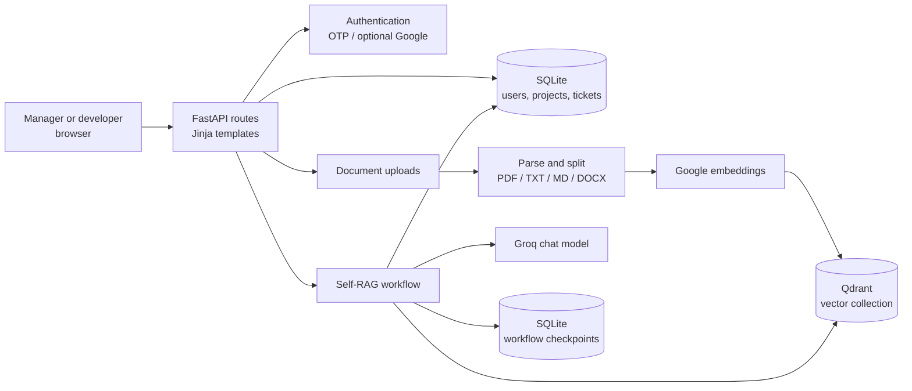
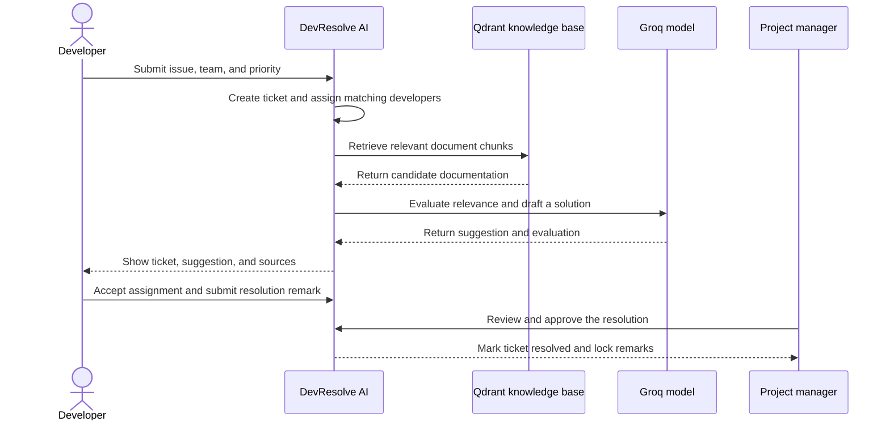

# DevResolve AI

**Turn engineering issues and team knowledge into actionable resolutions.**

DevResolve AI is a FastAPI web application for managing project access, engineering tickets, team assignments, and internal troubleshooting documents. When a developer submits a ticket, a retrieval-augmented generation (RAG) workflow can search uploaded documentation and generate a suggested solution for the team to review.

> **Project status:** This repository contains an application under active development. AI suggestions are advisory; validate them before applying changes to production systems.

## What it does

- **Role-based workspaces** for project managers and developers.
- **Account registration and access approvals** tied to a project.
- **Email/password sign-in with one-time passcode verification**, with optional Google OAuth.
- **Issue tracking** with team, priority, assignment, acceptance, developer remarks, and manager resolution approval.
- **AI-assisted troubleshooting** that searches uploaded runbooks and produces a structured suggestion with source references when available.
- **Knowledge-base uploads** for PDF, TXT, Markdown, and DOCX documents.
- **Developer activity updates** and dashboard summaries.

## How it fits together



### Ticket-to-suggestion flow



The AI workflow can rewrite the retrieval query when useful. If it cannot find relevant internal documentation after its configured retries, it returns general troubleshooting guidance and suggests where to look next. Generated text is not an automatic fix and should be reviewed by a developer.

## Roles and workflows

| Role | Main capabilities |
| --- | --- |
| **Manager** | View project dashboards and tickets, approve or reject developer access requests, manage developer roles, review uploaded documents, and approve ticket resolutions. |
| **Developer** | Request project access, raise and track issues, accept an assignment, submit a resolution remark, add daily updates, and upload troubleshooting documents. |

New developer accounts require manager approval before using the developer workspace. Tickets are routed to approved developers whose assigned role matches the selected team. A manager's resolution approval marks the ticket resolved and locks the accepted developer's remark.

## Technology

- **Backend:** Python, FastAPI, SQLAlchemy
- **UI:** Jinja2 server-rendered templates, static CSS and JavaScript
- **Application database:** SQLite
- **AI orchestration:** LangChain and LangGraph
- **LLM:** Groq chat API
- **Embeddings:** Google Generative AI embeddings
- **Vector search:** Qdrant
- **Authentication integrations:** signed session middleware, JWT-based app tokens, optional Google OAuth, email OTP

## Get started

### Requirements

- Python 3.10 or newer
- `pip`
- API credentials for the AI features you want to enable; see [Configuration](#configuration)

### 1. Create an environment and install dependencies

**Windows PowerShell**

```powershell
py -3 -m venv .venv
.\.venv\Scripts\Activate.ps1
python -m pip install --upgrade pip
pip install -r requirements.txt
```

**macOS / Linux**

```bash
python3 -m venv .venv
source .venv/bin/activate
python -m pip install --upgrade pip
pip install -r requirements.txt
```

### 2. Configure environment variables

Copy `.env.example` to `.env`, then set the values for your environment.

**Windows PowerShell**

```powershell
Copy-Item .env.example .env
```

**macOS / Linux**

```bash
cp .env.example .env
```

At minimum, set a private `SECRET_KEY`. To enable document-grounded AI answers, configure a Groq API key, a Google API key, and a persistent Qdrant URL and API key. See the [configuration reference](#configuration) for details.

### 3. Start the application

```bash
uvicorn app:app --reload
```

Open [http://localhost:8000](http://localhost:8000). FastAPI's interactive API documentation is available at [http://localhost:8000/docs](http://localhost:8000/docs), and the health endpoint is [http://localhost:8000/health](http://localhost:8000/health).

On startup, the application creates the SQLite tables and seeds example projects and a demo manager account. See [Local demo account](#local-demo-account).

## Configuration

The application reads configuration from environment variables and `.env`. The complete set of example values is in [.env.example](./.env.example).

| Variable | Purpose | Default / notes |
| --- | --- | --- |
| `APP_URL` | Public/base application URL. | `http://localhost:8000` |
| `SECRET_KEY` | Signs session data. Use a unique, high-entropy secret outside local development. | Development placeholder; **replace it**. |
| `DATABASE_URL` | SQLAlchemy database connection URL. | `sqlite:///./data/devresolve.db` |
| `DATABASE_PATH` | SQLite file path used to ensure the database directory exists. | `data/devresolve.db` |
| `GOOGLE_CLIENT_ID`, `GOOGLE_CLIENT_SECRET` | Enable Google OAuth sign-in. | Empty values disable Google sign-in. |
| `GOOGLE_REDIRECT_URI` | OAuth callback registered with Google. | `http://localhost:8000/auth/google/callback` |
| `SMTP_HOST`, `SMTP_PORT`, `SMTP_USER`, `SMTP_PASSWORD` | Configure email delivery for OTP and notifications. | Gmail host and port are provided; credentials are empty. |
| `FROM_EMAIL` | Sender address for application email. | `noreply@devresolve.ai` |
| `GROQ_API_KEY` | Enables the chat model used to generate and evaluate ticket suggestions. | Required for AI suggestions. |
| `GROQ_MODEL` | Groq model name. | `llama-3.3-70b-versatile` |
| `GOOGLE_API_KEY` | Enables Google embedding requests for document indexing and retrieval. | Required for document-grounded retrieval. |
| `GEMINI_EMBEDDING_MODEL` | Google embedding model name. | `gemini-embedding-001` |
| `EMBEDDING_PROVIDER`, `EMBEDDING_DIMENSION` | Embedding settings and Qdrant vector size. | `google`, `768` |
| `QDRANT_URL`, `QDRANT_API_KEY` | Connect to a Qdrant service. Both must be set to use the configured remote service. | If either is empty, the app uses an in-memory Qdrant client; its vectors do not persist across restarts. |
| `QDRANT_COLLECTION_NAME` | Collection used for document vectors. | `devresolve_docs` |
| `TOP_K` | Number of nearest document chunks requested during retrieval. | `5` |
| `MAX_SUPPORT_RETRIES`, `MAX_RETRIEVAL_REWRITES` | Bound support-check and retrieval-rewrite attempts. | `2` each |
| `MAX_WEB_REWRITES` | Present in the settings template. | No web-search workflow is currently wired into the ticket RAG graph. |
| `OTP_EXPIRE_MINUTES` | OTP expiry setting. | `10` |

### Local demo account

The startup seed creates this manager account for local evaluation:

```text
Email:    admin@devresolve.ai
Password: Admin@123
```

When SMTP credentials are absent, the login flow displays the generated OTP in the development interface. Do not expose this demo account or development OTP behavior to untrusted users. The seed code also resets the demo account password on startup; change or remove that behavior before deploying the application.

## AI knowledge-base workflow

1. A developer uploads a `.pdf`, `.txt`, `.md`, or `.docx` document.
2. The application stores the uploaded file in `uploads/`, extracts its text, and splits it into overlapping chunks.
3. Chunks are embedded with the configured Google embedding model and written to the configured Qdrant collection.
4. When a ticket is raised, the RAG graph retrieves up to `TOP_K` chunks, grades relevance, and generates a structured solution with the Groq model.
5. The graph checks support and usefulness, and may rewrite the query within configured limits.
6. The ticket stores the suggestion, route label, and source references. Developers and managers can review the suggestion in the ticket workflow.

When the workflow generates a solution, it is organized into **Problem Analysis**, **Suggested Solution**, and **Prevention Tips**. If retrieval cannot find relevant documentation, the workflow uses its general-guidance fallback instead. Source availability and answer quality depend on the configured services and indexed documents.

## Routes at a glance

| Area | Routes |
| --- | --- |
| Public | `/`, `/health` |
| Authentication | `/auth/login`, `/auth/register`, `/auth/verify-otp`, `/auth/google`, `/auth/logout` |
| Manager workspace | `/manager/dashboard`, `/manager/requests`, `/manager/tickets`, `/manager/team`, `/manager/documents` |
| Developer workspace | `/developer/dashboard`, `/developer/my-issues`, `/developer/raise-ticket`, `/developer/upload-document`, `/developer/ticket/{ticket_id}` |

Most workspace pages are browser-facing HTML routes, and their form submissions use POST routes. Consult the router modules for the complete route behavior.

## Repository layout

```text
.
├── app.py                   # FastAPI app, middleware, startup, and root routes
├── requirements.txt         # Python dependencies
├── .env.example             # Environment variable template
├── documents/               # Example runbooks for ingestion
├── src/
│   ├── auth/                # Password, JWT, OTP, and Google OAuth helpers
│   ├── rag/                 # Document ingestion, vector store, and Self-RAG graph
│   ├── routers/             # Authentication, manager, and developer routes
│   ├── config.py            # Application settings
│   └── database.py          # SQLAlchemy models, initialization, and seed data
├── static/                  # CSS and JavaScript assets
├── templates/               # Jinja2 pages for public, auth, and workspace views
├── uploads/                 # Uploaded source documents
└── data/                    # SQLite application and RAG checkpoint databases
```

The `documents/` directory includes example runbooks such as checkout API, deployment rollback, and payments high-CPU guides. Upload supported documents through the developer workspace to add them to the retrieval corpus.

## Development notes

- SQLite tables are created at startup using SQLAlchemy metadata; Alembic is listed as a dependency, but no migration workflow is documented here.
- With no remote Qdrant configuration, the in-memory vector store is useful for a local walkthrough but loses its index when the process exits.
- Ticket creation is persisted before the RAG call. If AI generation fails, the ticket remains available, but its AI suggestion may be empty; inspect application logs and check the API credentials and service configuration.
- Keep `.env`, real credentials, uploaded customer data, and local database contents out of public repositories.

## License

See [LICENSE](./LICENSE).
